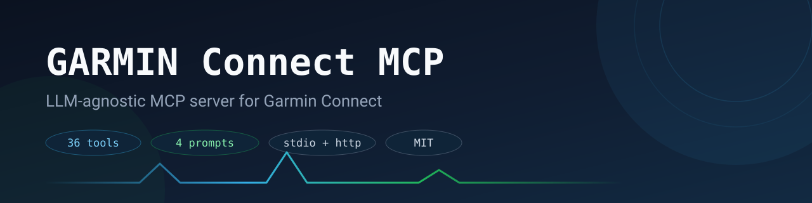

[](https://www.python.org/)
[](https://modelcontextprotocol.io/)
[](LICENSE)
[](https://github.com/sheloab/GARMIN-Connect-MCP/actions/workflows/ci.yml)

# GARMIN Connect MCP

**LLM-agnostic Garmin Connect MCP server** for sleep and naps, recovery, Body Battery, training readiness, training load, running tolerance, VO2 Max, endurance and hill scores, race predictions, gear mileage, and running summaries.

Use the same local Garmin tools from any MCP client — Cursor, Continue, Codex CLI, Gemini CLI, Hermes, opencode — or from provider-backed demo agents using DeepSeek, OpenAI, OpenRouter, or Gemini.

## Tribute & Thanks

GARMIN Connect MCP is built on **[kavakoss/mcp-garmin-connect](https://github.com/kavakoss/mcp-garmin-connect)**. The original MCP server, Garmin client, caching layer, running tools, demo mode and test suite are the work of **[kavakoss](https://github.com/kavakoss)**. Huge thanks for building it and sharing it as open source under the MIT License. 🙏

This project extends that foundation with richer sleep data (naps, stages, overnight vitals), 20 new tools, and activity weather plus time in HR and power zones. The full original history lives in kavakoss's repository linked above.

## What's New In This Version

- **Richer `get_sleep`** — naps (time, length, Garmin feedback), deep/light/REM/awake stages with ratings, bedtime and wake time, overnight HRV, SpO2, respiration, sleep stress, Body Battery recharge, skin temperature, and Garmin's sleep need with recommended bedtime.
- **20 new tools** — per-km splits from the raw recording, run/walk/stop segments, night-by-night sleep timeline, hour-by-hour day timeline, 90-day HRV trend, 52-week trends, daily activity, Body Battery, daily vitals, training readiness history, performance metrics, race prediction trend, running tolerance, saved workouts, yearly totals, badges, gear, devices, and body metrics (see [MCP Tools](#mcp-tools)).
- **Richer existing tools** — real HR and power zone ranges in `get_zones`, shoe usage in `get_gear`, watch alarms in `get_devices`.
- **Richer `get_activity_detail`** — weather during the activity (°C, km/h) and minutes in each heart-rate and power zone.
- **Fix** — `get_recovery` reports recovery time in hours (Garmin returns minutes).

## See It In Action


Recorded with `garmin-mcp serve --demo`, which serves deterministic **fictional** sample data — no Garmin credentials and no real health data involved:

```bash
uv run garmin-mcp serve --demo
```

## Works With Any MCP Harness

This server implements standard MCP over `stdio` and Streamable HTTP, so there is no harness-specific adapter to maintain. If your tool speaks MCP, it works:

| Harness | Connection |
|---|---|
| Codex CLI | MCP server config |
| Gemini CLI | MCP server config |
| Cursor, Windsurf, Zed, VS Code Copilot, Continue | MCP server settings (stdio or HTTP) |
| opencode | `mcp` block in `opencode.json` |
| Hermes | stdio or HTTP |
| Other desktop and CLI clients | `mcpServers` stdio config |
| Custom agents, web bots, scripts | Streamable HTTP at `http://127.0.0.1:8765/mcp` |

Any client that supports MCP over `stdio` or Streamable HTTP can use every tool and prompt in this server with no extra code.

## Why This Exists

Most fitness advice from LLMs is generic. This server lets an LLM inspect your real Garmin Connect data first, then answer with context from your activities, recovery markers, HRV, sleep, naps, Body Battery, stress, VO2 Max, and running history.

The core server is provider-neutral. DeepSeek, OpenAI, OpenRouter, and Gemini integrations are optional demo bridges for clients that do not speak MCP directly.

## Two Garmin Backends

| | **personal** (official) | **unofficial** (email/password) |
|---|---|---|
| Auth | Self-serve API key → 24 h bearer token | Garmin SSO + cached tokens |
| Stability | Documented, rate-limit friendly | Breaks when SSO/Cloudflare changes |
| Raw `.FIT` download | ✅ | ❌ |
| Sleep/HRV/stress/body battery/RHR/weight/SpO2/steps | ✅ | ✅ |
| Training status/load, readiness, VO2 Max, race predictions, personal records | ❌ | ✅ |

`GARMIN_AUTH_MODE` picks the strategy:

- `auto` (default) — official Personal API when `GARMIN_PERSONAL_API_KEY` is set, else email/password.
- `personal` / `unofficial` — force one backend.
- `hybrid` — run **both**: wellness and raw-file reads go to the official API, Garmin-derived metrics go to email/password, with automatic fallback when a call fails. This is the only mode that returns derived metrics *and* raw `.FIT` files from one process. It needs both credential sets. Tools that need a metric the active backend cannot see return that field as `null` with an `errors` entry explaining why, instead of failing the whole call. Setup and endpoint mapping: [docs/personal-api.md](docs/personal-api.md).

## Features

- **59 Garmin tools and 6 prompt templates** for training, recovery and sleep analysis.
- **Two Garmin backends, switchable or combined**: the official [Connect Personal API](docs/personal-api.md) (self-serve key, stable) and the unofficial email/password flow. `GARMIN_AUTH_MODE=hybrid` routes each read to the backend that owns it.
- **Raw activity files**: `download_activity_file` fetches the original `.FIT` (ZIP) through the Personal API.
- **Demo mode** — `serve --demo` runs on fictional sample data with no credentials, for try-outs and recordings.
- **Local MCP server** over `stdio` or Streamable HTTP (`/mcp`).
- **Endpoint-level TTL cache with single-flight factories** — concurrent tool calls share one Garmin request instead of stampeding the API.
- **Global request concurrency cap** so parallel snapshots stay within a safe request rate.
- **Partial-error reporting** — composite tools include an `errors` array when an endpoint fails, instead of silently returning nulls.
- **Metric units** — Garmin's imperial weather values and gram-based weights are converted for you.
- **Provider demo bridge** for `deepseek`, `openai`, `openrouter`, and `gemini`.
- **Explicit opt-in** before Garmin health/activity data is sent to any external LLM provider.
- **Mocked test suite** plus optional live Garmin smoke tests.

## How It Works

[MCP (Model Context Protocol)](https://modelcontextprotocol.io/) is an open standard that lets AI assistants call local "tools". This project is an MCP server: it runs on your own computer, logs in to Garmin Connect with your account, and exposes your data as tools your AI client can call when you ask a question.

```text
Garmin watch ──sync──▶ Garmin Connect app ──▶ Garmin Connect (cloud)
                                                     │
                                         GARMIN Connect MCP (runs locally)
                                                     │  MCP tools
                                                     ▼
                                 Your AI client (Cursor, Codex CLI, Gemini CLI, opencode, …)
```

Your Garmin password and login tokens stay on your machine. The AI client only sees the tool results it asks for.

## Getting Started (Step by Step)

### 1. Install the prerequisites

| You need | Why | How |
|---|---|---|
| **Git** | Download this repository | [git-scm.com/downloads](https://git-scm.com/downloads) |
| **uv** | Installs Python 3.11+ and all dependencies for you | macOS/Linux: `curl -LsSf https://astral.sh/uv/install.sh \| sh`<br>Windows (PowerShell): `powershell -ExecutionPolicy ByPass -c "irm https://astral.sh/uv/install.ps1 \| iex"` |
| **A Garmin Connect account** | The data source (not needed for demo mode) | Your watch should be syncing to the Garmin Connect app |
| **A Garmin Personal API key** (recommended) | Lets the official backend read your data | See [Get your Personal API key](#get-your-personal-api-key) below |
| **An MCP client** | The AI you will chat with | Any client from [Works With Any MCP Harness](#works-with-any-mcp-harness) |

You do not need to install Python yourself; `uv` downloads a suitable version automatically.

#### Get your Personal API key

The key is self-serve. You don't need to apply or wait for approval.

1. Sign in to [Garmin Connect](https://connect.garmin.com) in a web browser (not the phone app), using the account your watch syncs to.
2. Open <https://connect.garmin.com/app/settings/personalApiToken>.
3. Click **Create Key** and accept the terms.
4. Choose how long the key stays valid: 30, 90, 180 or 365 days.
5. **Copy the key right away.** Garmin shows it only once. If you lose it, delete it and create a new one.
6. Keep the key somewhere safe, such as a password manager. You will paste it into `.env` in [step 4](#4-add-your-garmin-credentials).

Treat the key like a password. Never commit it or share it in chats or issues. You can revoke it, or create a replacement when it expires, on the same page. If you'd rather not use a key, skip this part and use the email/password backend in step 4.

### 2. Download the code

```bash
git clone https://github.com/sheloab/GARMIN-Connect-MCP
cd GARMIN-Connect-MCP
uv sync
```

### 3. Try it without a Garmin account (optional)

Demo mode serves **fictional** sample data, so you can check everything works before entering any credentials:

```bash
uv run garmin-mcp tools          # lists all tools and prompts
uv run garmin-mcp serve --demo   # starts the server on fictional data (Ctrl+C to stop)
```

To try demo mode inside your AI client, add `"--demo"` to the end of the `args` list in the client config shown in [MCP Client Setup](#mcp-client-setup).

### 4. Add your Garmin credentials

Copy the example settings file and fill in your Garmin Connect email and password:

```bash
cp .env.example .env              # Windows PowerShell: Copy-Item .env.example .env
```

Pick a backend in `.env`:

```env
# Official Personal API (recommended): paste the key from
# "Get your Personal API key" in step 1
GARMIN_AUTH_MODE=personal
GARMIN_PERSONAL_API_KEY=your-key-here
```

or the unofficial email/password flow:

```env
GARMIN_AUTH_MODE=unofficial
GARMIN_EMAIL=you@example.com
GARMIN_PASSWORD=your-password
```

### 5. Log in once

The unofficial flow needs a one-time interactive login (MFA supported); the
Personal API needs no login step:

```bash
uv run garmin-mcp login                  # unofficial backend only
uv run garmin-mcp personal-api --check   # official backend: token + sample per endpoint
uv run garmin-mcp doctor --live
```

Run this in a normal terminal: if your account uses two-factor authentication, Garmin sends a code and the command asks you to type it. The login tokens are saved in `~/.garminconnect` (change with `GARMIN_TOKEN_STORE`), so later starts do not need to log in again.

### 6. Check the setup

```bash
uv run garmin-mcp doctor --live
```

Every required line should say `OK`. `WARN` lines for provider keys are fine if you do not use the provider demo agents.

### 7. Connect your AI client

Add the server to your client's MCP configuration (see [MCP Client Setup](#mcp-client-setup) below), replacing `/path/to/GARMIN-Connect-MCP` with the folder you cloned. Restart the client, and the Garmin tools appear in its tool list.

You can also run the server yourself, over stdio or HTTP:

```bash
uv run garmin-mcp serve --transport stdio
uv run garmin-mcp serve --transport http --host 127.0.0.1 --port 8765
# HTTP clients connect to http://127.0.0.1:8765/mcp
```

### 8. Ask your first questions

Just ask in plain language; the AI picks the right tools. For example:

| Ask | Tools it will likely use |
|---|---|
| "How recovered am I today? Should I train hard?" | `get_recovery`, `get_training_readiness_history` |
| "Analyze last night's sleep. Why was my REM low?" | `get_sleep`, `get_sleep_detail` |
| "Break my last run down per kilometre." | `get_recent_activities`, `get_activity_distance_splits` |
| "Did I stop or walk during my last run?" | `get_activity_segments` |
| "What drained my Body Battery yesterday?" | `get_body_battery`, `get_daily_timeline` |
| "How has my HRV trended over the last 3 months?" | `get_hrv_trend`, `get_long_term_trends` |
| "Am I increasing my running load too fast?" | `get_running_tolerance`, `get_training_load` |
| "Plan an easy run for tonight in my real HR zones." | `get_zones`, `get_recovery` |
| "How many km have my shoes done?" | `get_gear` |
| "How much have I run this year?" | `get_yearly_totals` |

More ready-to-use prompts are in [Example Prompts](#example-prompts).

### Keeping the data fresh

The server reads what is in Garmin Connect, not what is on your watch. **Sync your watch in the Garmin Connect app before asking**, otherwise you get the data from the last sync (`get_devices` shows the last upload time). Responses are cached for 2 minutes (`GARMIN_CACHE_TTL_SECONDS`), so after syncing, wait a moment before asking again.

## Example Prompts

Copy any of these into your AI client. Change the dates, distances and goals to match your own.

### Sleep

- "How did I sleep last night? Compare it with my 7-day average."
- "Why was my REM sleep low last night? Show the stage timeline."
- "What time did I go to bed and wake up this week, and how consistent was it?"
- "Did my naps this week help or hurt my night sleep?"
- "What bedtime does Garmin recommend for me tonight, and why?"
- "Show my SpO2 and breathing during sleep. Were there any dips?"
- "How has my sleep score trended over the last 30 days?"

### Recovery and HRV

- "How recovered am I today? Should I train hard, train easy or rest?"
- "Explain my training readiness score. Which factor is pulling it down?"
- "How has my HRV trended over the last 90 days? Am I within my baseline?"
- "My resting heart rate went up this week. What could be causing it?"
- "Compare my stress levels on workdays and weekends."
- "Am I showing any signs of overtraining or getting sick?"

### Body Battery and energy

- "What's my Body Battery right now, and what drained it today?"
- "How much did my Body Battery recharge overnight?"
- "Which activities or times of day drain my Body Battery the most?"
- "Show my Body Battery highs and lows for the past week."
- "Hour by hour, how did my heart rate, stress and Body Battery change yesterday?"

### Running coach

- "Analyze my last run: pace, heart rate, cadence and splits per km."
- "Did I walk or stop during my last run? How much time did I lose?"
- "Plan an easy run for tonight using my real heart-rate zones."
- "Build me a 12-week half marathon plan based on my current fitness."
- "How long do I need to train for a 10K? Recommend a plan length."
- "Am I increasing my running load too fast? Check my running tolerance and training load."
- "What are my race predictions, and how have they changed this month?"
- "How did my VO2 Max, endurance score and lactate threshold change lately?"
- "When is the best time to run this week, based on air quality where I usually run?"
- "Review my running this month: volume, pace, longest run and what to improve."

### Training and activity

- "Summarize my training this week by sport."
- "How many steps and intensity minutes did I get today compared with my goal?"
- "Show my saved workouts and explain the structure of [workout name]."
- "How much have I run, walked and cycled this year?"
- "List my personal records and tell me which ones are within reach."

### Gear, devices and body

- "How many kilometres do my running shoes have? When should I replace them?"
- "When did my watch last sync, and what firmware is it on?"
- "Show my weight and body composition trend."
- "Which badges am I close to earning?"

### Full check-ins

- "Give me a full health review: sleep, recovery, stress, Body Battery and training."
- "Write my weekly training review, with what went well and what to change next week."
- "Act as my running coach. Look at my last 4 weeks and tell me what to do this week."
- "Compare this month with last month for sleep, resting HR, HRV and running volume."

## MCP Client Setup

Generic `stdio` config for a local checkout:

```json
{
  "mcpServers": {
    "garmin": {
      "command": "uv",
      "args": [
        "--directory",
        "/path/to/GARMIN-Connect-MCP",
        "run",
        "garmin-mcp",
        "serve",
        "--transport",
        "stdio"
      ]
    }
  }
}
```

Credentials are read from the repo's `.env` file, so no `env` block is needed.

[opencode](https://opencode.ai) (`opencode.json`):

```json
{
  "mcp": {
    "garmin": {
      "type": "local",
      "command": [
        "uv",
        "--directory",
        "/path/to/GARMIN-Connect-MCP",
        "run",
        "garmin-mcp",
        "serve",
        "--transport",
        "stdio"
      ],
      "enabled": true
    }
  }
}
```

Per-client examples (Cursor, Continue, Hermes, generic stdio/HTTP) live in [docs/clients](docs/clients/README.md).

## MCP Tools

### Recovery and sleep

| Tool | Purpose |
|---|---|
| `get_recovery` | Readiness, HRV, sleep, body battery, resting HR, training status if available |
| `get_sleep` | Sleep duration and score, naps, stages, bedtime/wake time, overnight HRV/SpO2/respiration/stress, and sleep need |
| `get_training_readiness_history` | **New.** Daily readiness score with each factor's contribution: sleep, sleep history, recovery time, acute load, stress history, HRV |
| `get_body_battery` | **New.** Charged, drained, high, low, level at wake, sleep recharge, latest level, and the events (sleep, naps, activities) that moved it |
| `get_resting_heart_rate` | Daily RHR with 7-day and 30-day trend summaries, up to 30 days |
| `get_stress` | Daily stress buckets and average stress |
| `get_daily_vitals` | **New.** Daily HR (min/max/resting), SpO2, respiration, time in rest/low/medium/high stress, and altitude |
| `get_sleep_detail` | **New.** One night in detail: stage-by-stage timeline with clock times, hourly HR/HRV/SpO2/stress/Body Battery, minutes of SpO2 below 90%, restless moments, breathing disruptions |
| `get_hrv_trend` | **New.** Up to 90 nights of HRV with 5-minute high, status, personal baseline range, and nights below baseline |
| `get_daily_timeline` | **New.** Hour-by-hour HR, stress, Body Battery, SpO2 and respiration for any day, plus auto-detected activities |
| `get_health_summary` | Compact recovery, sleep, RHR, and stress snapshot |

### Activity and training

| Tool | Purpose |
|---|---|
| `get_daily_activity` | **New.** Steps vs goal, distance, floors, calories, intensity minutes, active/sedentary time, and weekly intensity minutes vs goal |
| `get_recent_activities` | Recent normalized activity summaries |
| `get_activity_detail` | One activity with training effect, weather, and time in HR and power zones |
| `get_activity_splits` | Per-lap splits with pace, HR, cadence, elevation and HR drift |
| `get_activity_distance_splits` | **New.** Per-km (or custom distance) splits computed from the second-by-second recording, independent of auto-lap: pace, grade-adjusted pace, HR, cadence, stride, ground contact, power, elevation, split pattern and aerobic decoupling |
| `get_activity_segments` | **New.** Garmin's run/walk/stand detection within an activity, with paused time |
| `get_recent_load` | Volume by sport based on recent activities |
| `get_training_load` | Native Garmin Training Load when the device/account exposes it |
| `get_running_tolerance` | **New.** Weekly running impact load as a percentage of Garmin's running tolerance |
| `get_running_summary` | Running summary with pace, HR, longest and fastest run |
| `get_monthly_running_stats` | Monthly running breakdown |
| `get_yearly_totals` | **New.** Year-to-date totals per sport: count, distance, time, average and longest |
| `get_workouts` | **New.** Saved workouts in your Garmin Connect library |
| `get_workout_detail` | **New.** Step-by-step structure of a saved workout with pace (min/km), HR, power and cadence targets |

### Performance

| Tool | Purpose |
|---|---|
| `get_fitness` | VO2 Max, FTP, and race predictions |
| `get_performance_metrics` | **New.** Endurance score and level, hill score, fitness age, lactate threshold (HR, pace, running power), heat/altitude acclimation, VO2 Max trend |
| `get_race_prediction_trend` | **New.** Daily 5K/10K/half/marathon predictions and how they changed |
| `get_zones` | Heart-rate zone ranges (bpm) per sport with max/resting/threshold HR, running power zones, and thresholds |
| `get_long_term_trends` | **New.** Up to 52 weeks of weekly steps, stress, HRV, resting HR, sleep, SpO2 and respiration with recent-vs-earlier comparison |
| `get_personal_records` | Garmin personal records |

### Gear, devices and body

| Tool | Purpose |
|---|---|
| `get_gear` | **New.** Shoes and other gear: distance, activity count, percent of max distance and km remaining, default activity types, last use, last-30-day usage |
| `get_devices` | **New.** Registered Garmin devices, firmware version, last upload, and alarms |
| `get_badges` | **New.** Earned badges and points, badges in progress, and joined challenges |
| `get_body_metrics` | **New.** Weigh-ins and body composition, blood pressure readings, and today's hydration |
| `get_hrv_history` | Daily HRV (last-night + weekly average) with a baseline over a longer window |
| `get_body_battery_range` | Daily body battery: charged, drained, highest, lowest, end of day |
| `get_body_composition` | Weight, BMI, body fat/muscle/water from Garmin weight entries — **Personal API only** |
| `get_spo2` | Daily blood oxygen (SpO2) — **Personal API only** |
| `get_hydration` | Logged daily fluid intake in millilitres — **Personal API only** |
| `get_steps_history` | Daily steps versus goal — **Personal API only** |
| `get_fitness_age` | Garmin fitness age versus chronological age — **Personal API only** |
| `download_activity_file` | Original activity file (ZIP with the `.FIT`) written to disk — **Personal API only** |
| `get_full_snapshot` | Broad multi-section Garmin snapshot; each section carries `data_source` (and `source_detail` when a section needed both backends) |

### Health, ECG and coaching

Read through the email/password backend (garminconnect 0.3.20+); GPS is stripped and long series are capped.

| Tool | Purpose |
|---|---|
| `get_health_snapshots` | Health Snapshot sessions (2-minute recording): HR, HRV, respiration, stress, SpO2; optional per-epoch samples |
| `get_ecg_readings` | ECG app recordings: rhythm classification, average HR, symptoms; one recording in detail, waveform on request (not a diagnosis) |
| `get_blood_pressure` | Last reading per day and 52 weekly averages |
| `get_cardio_respiratory` | Daily resting/min/max HR, respiration, SpO2 acclimation, weekly HR incl. abnormal-HR alerts |
| `get_sleep_stats` | Overall and weekly sleep statistics, today's naps |
| `get_glucose` | Logged glucose readings (manual or CGM) |
| `get_wellness_trends` | Weekly calories, floors, hydration, fitness age; daily stress, body battery, intensity minutes; monthly steps; lifetime totals |
| `get_advanced_performance` | Running economy, stamina curve, running power curve and FTP, heat/altitude acclimation, 4-week load balance, weekly training status, readiness history, biometrics, fitness-age targets, cycling ability, swim CSS |
| `get_training_plan_context` | Primary race, upcoming events, active training plans, scheduled workouts, PacePro bands, fastest splits, PR candidates |
| `get_activity_extras` | One activity's laps, workout-step results, strength sets, power curve, gear, badges and PRs |
| `get_athlete_profile` | Personal information, HR zones (v2), power zones, units, timezone, devices, sensors, last sync |
| `list_garmin_methods` | Every read-only Garmin method `garmin_read` can call, with parameters |
| `garmin_read` | Call any `get_*` Garmin method by name (read-only; auth-header and edit/delete/upload methods are blocked) |

Prompts `health_review` and `running_coach_program` chain these tools into a full health review and a periodized, coach-style running plan.

### Coaching and air quality

| Tool | Purpose |
|---|---|
| `build_running_plan` | Evidence-based plan for 10K, half or marathon. `weeks=0` recommends a length (2, 4, 8, 12 or 16 weeks) from your last 12 weeks of running; then it builds week-by-week volume, long run, sessions with VDOT paces and your HR zones, strength work, adjustment rules and cited studies |
| `get_running_air_quality` | Finds your usual running areas from activity start points (rounded to `AIR_QUALITY_GRID_DEG`, default 0.01 deg ~ 1 km; exact GPS never leaves), then reports PM2.5, PM10, ozone, NO2 and US AQI during your runs, the cleanest hours per area and a forecast of the best run windows (Open-Meteo / CAMS) |

Evidence built into the plan rules: Frandsen et al. 2025 (single-session spikes, Br J Sports Med), Buist et al. 2008 (10% rule RCT), Nielsen et al. 2014 (weekly progression, JOSPT), Seiler & Kjerland 2006 and Stoggl & Sperlich 2014 (intensity distribution), Bosquet et al. 2007 (taper meta-analysis), Blagrove et al. 2018 (strength training), Kiviniemi et al. 2007 (HRV-guided training), Giles & Koehle 2014 and WHO 2021 (air pollution), Roberts et al. 2023 (ACSM heat illness), Daniels (VDOT paces). Every plan returns the list with what each rule changed.

## Activity windows

`get_recent_activities` accepts either a lookback (`days`) or an explicit window:

```jsonc
{ "days": 30 }                                          // newest 30 days
{ "start_date": "2026-08-01", "end_date": "2026-08-31" } // August 2026 only
```

Both dates are inclusive and `YYYY-MM-DD`; `end_date` defaults to today. Explicit dates win over `days` and make a **past** window queryable without pulling every newer activity first — the pager walks backwards and stops once it reaches `start_date`. The response then includes the resolved `window` so callers can see exactly what was queried. Invalid or reversed dates return an `error` field instead of silently returning everything.

## MCP Prompts

- `recovery_check`
- `weekly_training_review`
- `activity_analysis`
- `race_plan_context`

## Configuration

All settings come from environment variables (`.env` is loaded automatically).

| Variable | Default | Purpose |
|---|---|---|
| `GARMIN_AUTH_MODE` | `auto` | `auto`, `personal` (official API), `unofficial` (email/password) or `hybrid` (both, routed per endpoint) |
| `GARMIN_PERSONAL_API_KEY` | — | Personal API key from [Connect settings](https://connect.garmin.com/app/settings/personalApiToken) — enables the official backend |
| `GARMIN_PERSONAL_TOKEN_CACHE` | `~/.garminconnect/personal_api_token.json` | Where the 24 h bearer token is cached (mode `0600`) |
| `GARMIN_PERSONAL_BASE_URL` | `https://personal.connectapi.garmin.com` | Personal API host override |
| `GARMIN_PERSONAL_TIMEOUT_SECONDS` | `20` | HTTP timeout for Personal API calls |
| `GARMIN_EMAIL` | — | Garmin Connect account email (unofficial backend only) |
| `GARMIN_PASSWORD` | — | Garmin Connect password (unofficial backend only) |
| `GARMIN_TOKEN_STORE` | `~/.garminconnect` | Directory for the OAuth token cache |
| `GARMIN_CACHE_TTL_SECONDS` | `120` | TTL for cached Garmin endpoint responses |
| `GARMIN_MAX_CONCURRENCY` | `3` | Global cap on in-flight Garmin requests |
| `AIR_QUALITY_ENABLED` | `1` | `0` turns off `get_running_air_quality` (no location ever sent) |
| `AIR_QUALITY_GRID_DEG` | `0.01` | Grid (degrees) that run start points are rounded to before the air-quality lookup |
| `GARMIN_LOGIN_COOLDOWN_SECONDS` | `900` | After a failed email/password login, tool calls stop trying to log in for this long (shared by every server process via `login_cooldown.json` in the token store); `0` disables |
| `GARMIN_DEVICE` | `samsung/SM-S928B/samsung; Android/35` | Phone in the `X-Garmin-User-Agent` header (`maker/model/brand; Android/API level`); set it to your own phone |
| `GARMIN_APP_VERSION` | `5.30.1` | Garmin Connect Android app version sent in the native API `User-Agent` headers |
| `GARMIN_MAX_DAYS_HEALTH` | `30` | Max lookback for `get_sleep` / `get_resting_heart_rate` / `get_stress` / `get_health_summary` |
| `GARMIN_MAX_DAYS_ACTIVITIES` | `365` | Max lookback for activities, training load and running summaries |
| `GARMIN_MAX_ACTIVITY_LIMIT` | `200` | Max activities returned per call (history is paged automatically) |
| `GARMIN_DEMO` | unset | `1` serves fictional sample data (same as `serve --demo`) |

Provider bridge variables (optional): `DEEPSEEK_API_KEY`, `OPENAI_API_KEY`, `OPENROUTER_API_KEY`, `GEMINI_API_KEY`, plus the matching `*_BASE_URL` and `*_MODEL` overrides.

## Field units

Garmin's raw payloads mix units, and some fields are named after a unit that Garmin does not actually use (see issue #3: `recoveryTime` is minutes, not hours). This table is the contract — if you add a field, add its row.

Daily arrays (`daily` on the sleep, stress, RHR, HRV and body-battery tools) are **newest-first** — index 0 is the most recent day. Sort client-side if you need chronological order.

| Field | Unit we expose | Garmin raw | Conversion |
|---|---|---|---|
| `duration` | `"h:mm:ss"` | `duration` (seconds) | formatted |
| `duration_min`, `duration_seconds` | minutes / seconds | `duration` (seconds) | `/60` |
| `distance_km`, `total_km`, `total_distance_km` | kilometres | `distance` (metres) | `/1000` |
| `pace_min_km`, `pace_seconds_per_km` | `"m:ss"` / s per km | `averageSpeed` (m/s) | derived |
| `hr_avg`, `hr_max`, `avg_hr`, `min_bpm`, `max_bpm`, `latest_bpm`, `*_avg_bpm` | bpm | `averageHR`, `maxHR`, `restingHeartRate` | – |
| `cadence_spm`, `avg_cadence` | steps per minute | `averageRunningCadenceInStepsPerMinute` | – |
| `avg_power_w`, `normalized_power_w`, `cycling_ftp_w` | watts | `avgPower`, `normPower`, `functionalThresholdPower` | – |
| `elevation_gain_m` | metres | `elevationGain` | assumed metres |
| `total_strokes` | count | `totalNumberOfStrokes` | – |
| `hours`, `avg_hours` | hours | `sleepTimeSeconds` (seconds) | `/3600` |
| `sleep_score`, `score`, `stress_avg`, `max_stress` | 0–100 | `sleepScores.overall`, `avgStressLevel` | – |
| `rest_minutes`, `low_minutes`, `medium_minutes`, `high_minutes`, `activity_minutes` | minutes | `*StressDuration` (seconds) | `/60` |
| `total_minutes`, `total_hours`, `total_duration_hours` | minutes / hours | `duration` (seconds) | derived |
| `last_night_avg_ms`, `weekly_avg_ms`, `hrv_weekly_avg` | milliseconds | `lastNightAvg`, `weeklyAvg`, `hrvWeeklyAverage` | – |
| `recovery_time_hours` | **hours** | `recoveryTime` (**minutes**) | `/60` (issue #3) |
| `body_battery_today.charged` | level | `charged` | – |
| `vo2_max_running`, `vo2_max_cycling` | ml/kg/min | `vo2MaxPreciseValue` | – |
| `race_predictions.*.seconds` | seconds | `time5K`, `time10K`, … | – |
| `drift_pct` | percent | computed from laps | – |
| `records[].value` | **mixed — read `value_unit`** | `value` | see below |
| `records[].value_unit` | `duration` \| `distance_m` \| `elevation_m` \| `watts` \| `steps` \| `days` | derived from the record label | – |

`recovery_time_hours` is only populated when the watch/account provides Training Readiness — a Forerunner 165, for example, returns no readiness data, so the whole `training_readiness` object is `null`. Other tools that lean on it degrade the same way rather than inventing numbers.

## How It Stays Fast And Quiet

- **Endpoint-level cache.** Sleeping, stress, RHR, and activity fetches are cached per day/limit and shared across every tool that needs them — a `get_full_snapshot` burst reuses the same responses instead of refetching.
- **Single-flight.** If two tool calls ask for the same missing key, only one hits Garmin; the other waits and reuses the result.
- **Failures are never cached.** A failed endpoint is retried on the next call.
- **Concurrency cap.** All outbound Garmin calls pass through one bounded semaphore (`GARMIN_MAX_CONCURRENCY`) so parallel sections cannot flood the API.
- **Visible partial failures.** When an optional endpoint fails, composite tools add an `errors` array (source + exception) to their output.

## Provider Demo Agents

Provider API access may require a paid account or credits even if the provider's web app has a free tier.

```env
DEEPSEEK_API_KEY=sk-...
OPENAI_API_KEY=sk-...
OPENROUTER_API_KEY=sk-or-...
GEMINI_API_KEY=...
```

| Provider | Env key | Default model | API style |
|---|---|---|---|
| DeepSeek | `DEEPSEEK_API_KEY` | `deepseek-v4-pro` | OpenAI-compatible Chat Completions |
| OpenAI | `OPENAI_API_KEY` | `gpt-5` | OpenAI Chat Completions |
| OpenRouter | `OPENROUTER_API_KEY` | `google/gemini-3-flash-preview` | OpenAI-compatible Chat Completions |
| Gemini | `GEMINI_API_KEY` | `gemini-3.6-flash` | Gemini Generate Content API |

```bash
uv run garmin-mcp ask "How is my recovery today?" --provider deepseek --allow-external-health-data
uv run garmin-mcp ask "Summarize my running for 90 days." --provider openai --allow-external-health-data
uv run garmin-mcp ask "What should I focus on this week?" --provider gemini --allow-external-health-data
```

The `--allow-external-health-data` flag is required because Garmin tool results can be sent to the selected provider.

## Privacy And Safety

- Your `.env` file and Garmin token cache stay local and are ignored by git.
- MCP clients that run locally can call Garmin tools without sending provider API keys to this project.
- Provider demo commands such as `garmin-mcp ask` can send Garmin health/activity results to the selected LLM provider, so the CLI requires `--allow-external-health-data`.
- `get_zones` returns only zone/threshold fields from the Garmin profile, not the raw profile (gender, birth date, weight, and similar PII are trimmed).
- Activity tools never return GPS coordinates, and workout/badge tools drop your Garmin display name and profile image, so routes and identity stay out of LLM conversations.

## Testing

```bash
uv run garmin-mcp doctor
uv run garmin-mcp doctor --live
uv run garmin-mcp tools
uv run ruff check .
uv run pytest
```

CI runs on Linux (Python 3.11, 3.12, 3.13) and Windows (3.12). Optional live tests are gated and never run in CI:

```powershell
$env:GARMIN_LIVE_TEST = "1"
uv run pytest tests/live
```

## Troubleshooting

- **`Garmin login paused until HH:MM`**: an earlier login failed (often a 429/Cloudflare block), so tool calls stop retrying until then. Wait, then run `uv run garmin-mcp login` once.
- **`Garmin rate-limited the request`** — lower `GARMIN_MAX_CONCURRENCY` (for example to `3`) and retry after a few minutes.
- **`Garmin authentication failed`** — check `GARMIN_EMAIL`/`GARMIN_PASSWORD`, then run `uv run garmin-mcp login` from a real terminal (MFA prompts need interactive input).
- **`Garmin rejected the Personal API key`** — keys expire after 30/90/180/365 days. Create a new one at <https://connect.garmin.com/app/settings/personalApiToken>, update `GARMIN_PERSONAL_API_KEY`, then `uv run garmin-mcp personal-api --check`.
- **`personal api required`** — that tool only exists on the official backend. Set `GARMIN_PERSONAL_API_KEY` and `GARMIN_AUTH_MODE=personal` (or `hybrid`).
- **A derived metric is `null` on the personal backend** — training status/load, readiness, VO2 Max, race predictions and personal records are not in Garmin's Personal API. Switch to `GARMIN_AUTH_MODE=unofficial` when you need them.
- **A tool returns `errors`** — the array names the endpoint that failed; the rest of the payload is still valid partial data.
- **A tool returns empty lists** (for example `get_body_metrics`) — nothing was logged in Garmin Connect for that period.
- **Today's data looks old** — sync the watch in the Garmin Connect app, wait a minute, and ask again; `get_devices` shows when the watch last uploaded.
- **The AI client does not show the Garmin tools** — check the `--directory` path in the client config points to your clone, then fully restart the client.

## Garmin Disclaimer

This project uses the community `garminconnect` Python package and Garmin Connect endpoints. Garmin Connect is not a public API for individual open-source projects, and authentication or endpoint behavior may change without notice. This project is not affiliated with or endorsed by Garmin.

Some metrics depend on Garmin device capabilities. For example, a device may expose VO2 Max and Training Effect but not native Garmin Training Load or Training Status. Zone availability depends on what the Garmin user settings endpoint exposes for your account.

## Contributing

Contributions are welcome. To add or change a tool:

1. Write the tool function in `src/mcp_garmin_connect/tools.py`. Fetch Garmin data through `_endpoint(...)` so it is cached and failures are reported in an `errors` array instead of crashing.
2. Register it in `TOOL_SPECS` at the bottom of the same file, with a clear docstring (it becomes the tool description the AI reads) and a JSON schema for its parameters.
3. Add a test in `tests/test_tools.py` using the `FakeGarmin` client with **fictional** values, and update the tool count in `tests/test_server.py`.
4. Run `uv run ruff check .` and `uv run pytest` before opening a pull request.

Please keep personal data out of contributions: no real Garmin IDs, GPS coordinates, health values or credentials in code, tests or issues.

## License

This project is licensed under the [MIT License](LICENSE).

Original work © 2026 [kavakoss](https://github.com/kavakoss) — [kavakoss/mcp-garmin-connect](https://github.com/kavakoss/mcp-garmin-connect). Extensions © 2026 [sheloab](https://github.com/sheloab).
